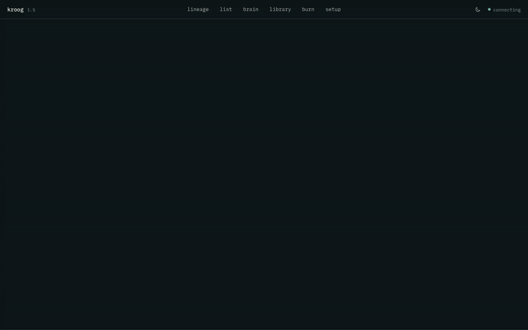
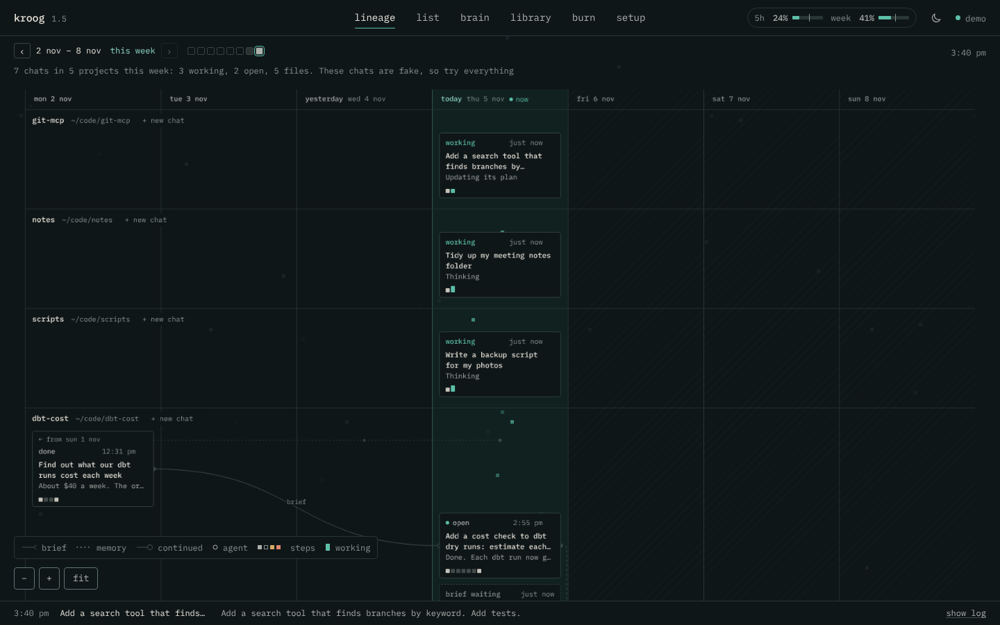
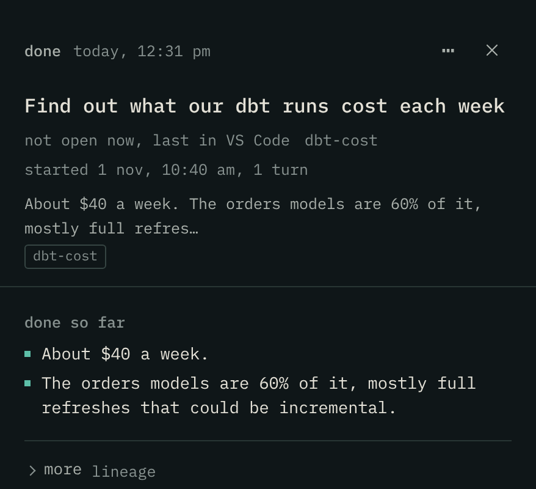
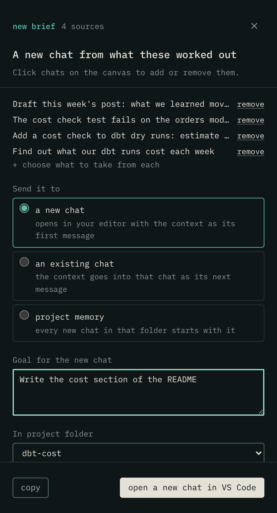
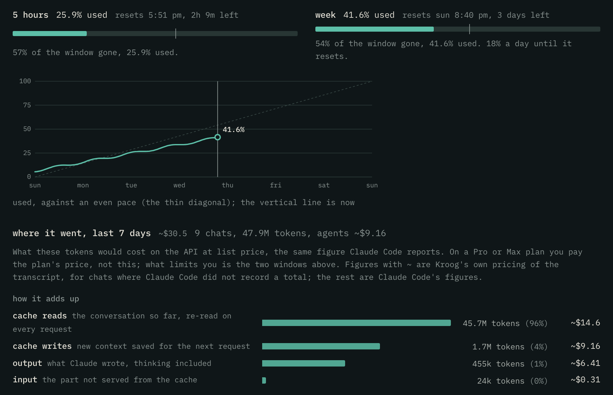
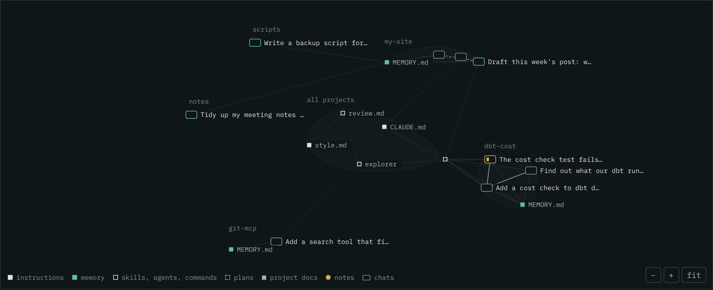

# Kroog

**The map of your Claude Code chats.**

Kroog is one browser tab, on your own computer, that shows every Claude Code chat you have in VS Code, Cursor or the terminal: what each one is about, what it got done, which ones are waiting on you, and how they came from each other. Pick two or three chats and Kroog starts a new chat whose first message is what they worked out. It also shows how fast you are using your plan's limits, and where the usage went.

Chats stay in Claude Code. Kroog never runs a chat and never edits your code. The only thing that leaves your computer is what its AI helper summarises, sent through your own Claude Code like any chat; with a local model, or the helper off, nothing does.



## Try it in a minute

With Node 20 or newer:

```
npx github:ishanyash/kroog demo
```

A tab opens with a week of made-up chats. The demo keeps its data in a temporary folder and changes nothing in Claude Code. Press Ctrl+C to stop it.

On Windows, run it in PowerShell. If PowerShell says running scripts is disabled, type `npx.cmd` instead of `npx`.

## Install

You need:

| | Version | Check |
| --- | --- | --- |
| macOS, Linux or Windows | Windows 10 or 11, no WSL needed. Linux also needs `lsof`, and `wl-copy` or `xclip` | |
| Node.js | 20 or newer | `node -v` |
| Claude Code | 2.1.224 or newer (2.1.234 on Windows); 2.1.299 or newer for the plan's usage windows | `claude --version`, or `/status` in a chat |
| Git | any version, to download Kroog and update it | `git --version` |
| VS Code or Cursor | any recent version, for opening chats from Kroog | optional |

On macOS or Linux, in the Terminal:

```
git clone https://github.com/ishanyash/kroog.git ~/kroog
cd ~/kroog
node bin/kroog.js link      # connect Claude Code to Kroog (backs up ~/.claude/settings.json first)
node bin/kroog.js start     # run it; opens its page with its key
```

On Windows, in PowerShell (or Windows Terminal):

```
git clone https://github.com/ishanyash/kroog.git $HOME\kroog
cd $HOME\kroog
node bin/kroog.js link
node bin/kroog.js start
```

The commands are the same after that on every system. On Windows, `~` below means your user folder, for example `C:\Users\you`.

Keep the window with `start` open while you use Kroog. If you close the tab, `node bin/kroog.js open` brings it back. Each time it starts, Kroog brings in chats from the last 7 days of Claude Code's history (up to 40), so the map is not empty. Chats that were already open start reporting after `/reload-plugins`, or in a new chat.

To update: `cd ~/kroog`, `git pull`, then `node bin/kroog.js stop` and `start`. To remove: `node bin/kroog.js unlink`, then delete `~/kroog` and `~/.kroog`.

Something not working? Run `node bin/kroog.js doctor`. It checks everything Kroog needs and says what to fix.

## What it does

### See: the week, project by project



Each column is a day, each band a project, each box a chat on the day it started. Lines show where a chat came from: a solid line is a brief, a dotted line is project memory. Every chat is in one of four states: **working**, **needs you** (waiting for a permission or an answer), **open** (finished its turn, still open in your editor) and **done**. Hover a chat for a one-line summary.

The pixels behind the week are live: every step a working chat takes drops a short run of cells under its box (a tool call, an agent's step, a question, a failure). It stands still if your system is set to reduce motion. Light and dark follow your system.

### Understand: a short read per chat



Click a chat for its profile: up to three lines on what has been done, up to two on what is left, and two buttons, **open in VS Code** and **new chat from this**. Everything else (what was asked, the plan, the files, the agents and what they came back with, the real conversation) is folded under **more**.

### Connect: start the next chat with the context of earlier ones



1. **Pick chats.** Take a suggested group on the **list** page (chats that look like the same work), or click the small link keys on the week view, or press **new chat from this** in a profile.
2. **Say where it goes.** A new chat (the usual case), an existing chat, or project memory for every future chat in that folder. Add a goal if you have one.
3. **Press the button.** VS Code opens a new chat, and the moment it appears in Claude Code's registry, Kroog sends the context into the chat's own inbox. It arrives as the first message.
4. **The chat reads and waits.** The message says it is background, not a task: reply in a few lines with what you now know, then stop. The chat does not read, run or change anything until you ask.

Kroog checks that the message arrived (Claude Code runs Kroog's hook for it). If the chat does not show up within 45 seconds, the context goes on your clipboard instead, and Kroog says so.

### Burn: your plan's limits, and where the usage went



The chip at the top of every page shows your plan's two windows, the 5-hour one and the week, each with a mark where an even pace would be; amber means you are ahead of pace. The **burn** page adds when the week runs out at this pace, and where the last seven days went: by day, project, model and chat, and **how it adds up** by kind of token.

The dollars are what the tokens would cost on the API at list price, the same figure Claude Code itself reports. On a Pro or Max plan you pay the plan's price, not this; the windows are what limit you. Most of the tokens are cache reads, because every request re-reads the conversation so far: long chats cost more per message.

The numbers come from Claude Code: each chat's own cost record in its transcript, and Kroog's **mod**, a small Claude Code plugin in this repository (`mod/`) that sends the plan's windows, with the chat's id, folder, cost and context size, to Kroog at 127.0.0.1 after each turn. `link` installs it. To install it by hand:

```
claude plugin install kroog --marketplace ishanyash/kroog
```

or, inside a chat, `/plugin marketplace add ishanyash/kroog` and then `/plugin install kroog@kroog`. Windows appear only on a claude.ai plan.

### Remember: a second brain



The **brain** page is a map and a search over what Claude Code already knows about your work: your `CLAUDE.md` files, rules, skills, agents, commands and plans, Claude Code's own memory for each project, and your Kroog notes. It never indexes settings, keys or transcripts. With [Ollama](https://ollama.com) and `embeddinggemma` it searches by meaning; without, by keyword. **add to claude code** gives every new chat a `kroog-brain` tool to look things up itself.

### The AI helper

The short lines (summaries, "done so far", group names, merged briefs) are written by a small model. By default that is Claude Code itself with Haiku, on your plan: about 3 seconds a call, never shown as a chat, with a daily cap (200 by default). In **Setup** you can use your own Anthropic API key or a local Ollama model instead, or turn it off; Kroog then takes the lines from each chat's own plan and last reply.

## Privacy and safety

- Kroog listens on `127.0.0.1` only. Other computers cannot reach it, and other websites cannot call it or show it in a frame.
- The page, the hooks and the mod all need Kroog's secret token (`~/.kroog/token`, readable by you only). Your browser gets it once, from the link `start` or `open` opens, and keeps it as a cookie; other programs and other accounts on your computer cannot use Kroog without it.
- Kroog never reads Claude Code's credentials or your Keychain, never edits your code, and never runs a chat. A message from Kroog arrives as a message from another session, which Claude Code never treats as your approval.
- Kroog approves nothing on its own. When a chat asks for a permission while a Kroog tab is open, Kroog holds the question for up to 30 seconds so you can answer it there; then your editor asks as usual. **Setup**, "answer here first", turns this off.
- No telemetry, no analytics, no update checks. The AI helper's input goes to Anthropic through Claude Code like any chat, or stays on your computer with Ollama.

[SECURITY.md](SECURITY.md) lists what Kroog reads, writes and connects to, and `node bin/kroog.js doctor` prints that list with your own paths. `test/boundary.test.js` checks the source for the main lines of it: the hosts the code names, where it listens, and no credential paths. It is a check on the code's text, not a sandbox.

## Commands

| Command | What it does |
| --- | --- |
| `node bin/kroog.js demo` | Made-up chats, in a temporary folder. Changes nothing in Claude Code. |
| `node bin/kroog.js link` | Connect Claude Code to Kroog and install the mod (`--no-mod` to skip it). Safe to run again. |
| `node bin/kroog.js start` | Run Kroog and open its page. Brings in the last 7 days of chats each time (`--no-import` to skip). |
| `node bin/kroog.js open` | Open the page of the Kroog that is running, with its key. |
| `node bin/kroog.js stop` | Stop the Kroog that is running. |
| `node bin/kroog.js doctor` | Check everything and print what Kroog touches. |
| `node bin/kroog.js status` | What is linked, and where Kroog keeps its files. |
| `node bin/kroog.js unlink` | Remove the hooks, the mod and the brain tool. Your data in `~/.kroog` stays. |

Add `--port 4878` to `link` and `start` to use another port.

## Where things live

| What | Where |
| --- | --- |
| The app | wherever you cloned it, for example `~/kroog` |
| Kroog's data: chats for the last 14 days, notes, briefs, usage readings (30 days), the brain index, settings, token, hook script, backups | `~/.kroog` |
| An API key, only if you add one | `~/.kroog/.env` (never your shell profile) |
| The hooks | `~/.claude/settings.json` |
| The page | `http://127.0.0.1:4877`, on your computer only |

## How it works

- **Hooks.** `link` adds hooks to Claude Code's settings. Each runs a small relay that tells Kroog what a chat is doing: `~/.kroog/hook.sh` (sh and curl) on macOS and Linux, `~/.kroog/hook.mjs` (Node) on Windows, where it works in Git Bash and in PowerShell. When Kroog is not running, the hook gives up in a moment and changes nothing.
- **The registry.** Claude Code keeps a list of its running chats in `~/.claude/sessions/`. Kroog reads it, so it knows which chats are open from the moment it starts.
- **Inboxes.** Every Claude Code chat has a private inbox: a socket only your user can reach on macOS and Linux, a named pipe on Windows. Kroog sends context there; that is also how a brand-new chat gets its first message.
- **Transcripts.** A chat's conversation and its cost come from Claude Code's own files in `~/.claude/projects/`. Kroog reads them and never changes them.
- **The mod.** A Claude Code plugin that reports the plan's usage windows, using Claude Code's plugin API.

## Limits

- Built on macOS with VS Code. On Linux, the map, the terminal chats, the burn page and context into open and new chats have been tested with real Claude Code; opening chats in VS Code on Linux has not.
- On Windows, every change is tested on GitHub's Windows machines: `link`, the hooks run the way Claude Code runs them (in Git Bash and in PowerShell), the map, the mod installed through Claude Code, `stop` and `unlink`. Sending context into a chat's inbox and opening chats in VS Code on Windows have not been tried with a real chat yet. If something does not work, `node bin/kroog.js doctor` says what, and an issue helps.
- Opening a chat from Kroog works best in VS Code; Cursor chats show up, but opening them from Kroog is less tested.
- Claude Code's registry, inbox, hooks and transcript format are partly internal and can change between versions. When something changes, Kroog falls back (for example to the clipboard) and says so.
- Plan windows need a Pro or Max plan and Claude Code 2.1.299 or newer.

## Questions

**Is this made by Anthropic?** No. It is an independent open-source tool built on Claude Code's features: hooks and plugins, which are documented, and its registry of open chats, chat inboxes and transcripts, which are partly internal.

**Does it cost anything?** Kroog is free. The AI helper's calls count toward your plan like a short chat, with a daily cap; turn it off in Setup if you like.

**Why not just ask Claude Code to summarise old chats?** You can, one chat at a time. Kroog keeps short summaries current for all of them, across editors and the terminal, and turns several chats into the start of the next one with one button.

**Can Kroog approve things in my chats?** Only when you press allow in Kroog, for a question it is holding while its tab is open. Messages Kroog sends arrive as messages from another session, and Claude Code never treats those as your approval.

## Contributing

Issues and pull requests are welcome; see [CONTRIBUTING.md](CONTRIBUTING.md). `npm test` runs the checks, including the style rules and the privacy boundary.

## Licence

MIT. See [LICENSE](LICENSE), and [NOTICE](NOTICE) for what Kroog ships with.

## Credits

- The font is IBM Plex Mono, under the SIL Open Font License (`public/fonts/LICENSE-IBM-Plex.txt`).
- The fish come from the [ascii-sharks](https://github.com/stackedlol/ascii-sharks) ocean (MIT License, `public/water-LICENSE.txt`).
- The look follows the floor set by [Hallmark](https://github.com/nutlope/hallmark) (MIT License): colours and type as tokens, contrast in both modes, visible focus, no animated layout, and motion that stops when you ask it to. `test/style.test.js` keeps those rules.
